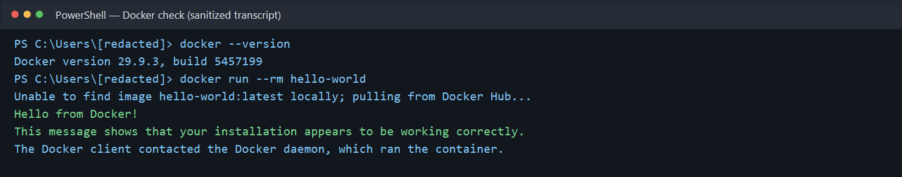
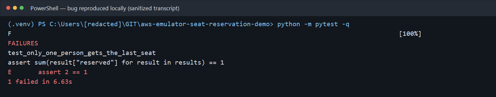
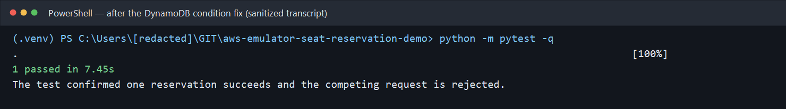

# AWS Emulator agent demo: don't oversell the last seat

This demo uses a familiar race condition: two customers request the last seat at the same time. The repository contains the fixed implementation in `reservations.py` and an intentionally buggy starting point in `starter/reservations.py`.

The test creates a fake concert and one fake seat in a local DynamoDB table. It sends two concurrent reservation requests and expects exactly one to succeed. To demonstrate the agent loop, copy the starter implementation over `reservations.py`, run the test to see it fail, and ask the coding agent to fix it. The expected fix is an atomic DynamoDB condition.

## Sanitized terminal captures

These images are recreated from the pasted PowerShell output. The Windows username has been redacted.







## What the demo shows

- The test data is invented and stays in the emulator; no customer or AWS data is needed.
- The emulator provides the local DynamoDB API and state.
- The application contains the reservation rule.
- The test states the expected business behavior.
- The coding agent investigates a failing test and changes the application code.

This tests the application’s use of DynamoDB and its response to a race for the last seat. It does not test VPC networking, IAM policy enforcement, or production traffic behavior.

Before presenting it, check the current [AWS Emulator DynamoDB fidelity](https://docs.aws.amazon.com/emulator/latest/userguide/fidelity.html), especially `UpdateItem` with a `ConditionExpression`. Fidelity can vary by operation and emulator release.

## 1. Build and start AWS Emulator

Start Docker Desktop. In a PowerShell window, from this folder, run:

```powershell
docker build -t aws-emulator .
New-Item -ItemType Directory -Force "$env:USERPROFILE\.aws\emulator"
$port = 9297
docker run --rm --memory=2g --memory-swap=2g -p "127.0.0.1:${port}:${port}" `
  -v "$env:USERPROFILE\.aws\emulator:/home/emulator/.aws/emulator" `
  aws-emulator -p $port --telemetry off
```

Leave this window open. The emulator creates local credentials and a certificate under `$env:USERPROFILE\.aws\emulator\9297` when it starts.

## 2. Configure and run the demo

Open a second PowerShell window in this folder and run:

```powershell
$env:AWS_ENDPOINT_URL = "https://127.0.0.1:9297"
$env:AWS_SHARED_CREDENTIALS_FILE = "$env:USERPROFILE\.aws\emulator\9297\emulator_credentials"
$env:AWS_CONFIG_FILE = "$env:USERPROFILE\.aws\emulator\9297\config"
$env:AWS_CA_BUNDLE = "$env:USERPROFILE\.aws\emulator\9297\ca.pem"
$env:AWS_EC2_METADATA_DISABLED = "true"
$env:AWS_DISABLE_HOST_PREFIX_INJECTION = "true"
$env:AWS_REGION = "us-east-1"
$env:AWS_DEFAULT_REGION = "us-east-1"
Remove-Item Env:AWS_ACCESS_KEY_ID, Env:AWS_SECRET_ACCESS_KEY, Env:AWS_SESSION_TOKEN, Env:AWS_PROFILE -ErrorAction SilentlyContinue

python -m venv .venv
.\.venv\Scripts\Activate.ps1
python -m pip install -r requirements.txt

# Reset the app to the intentionally buggy starter version for the live demo.
Copy-Item .\starter\reservations.py .\reservations.py -Force

python -m pytest -q
```

The test is expected to fail because both requests can reserve the final seat.

## 3. Ask the coding agent to fix it

Give the agent the request in [AGENT_DEMO_PROMPT.md](AGENT_DEMO_PROMPT.md). The prompt tells it the requirement, asks it to use the local emulator, and asks it to rerun the test after its change.

The expected fix is an atomic DynamoDB `ConditionExpression` on the inventory update, so the update succeeds only when at least one seat remains. A failed condition should be reported as “sold out.” The fixed version is in the published `reservations.py`; restore it with `git checkout -- reservations.py` after the demo if you want to return to the known passing state.

Stop the emulator with **Ctrl+C** in the first window. The local table and seat data are cleared when the emulator stops.

## Safety

The application refuses to create its DynamoDB client unless `AWS_ENDPOINT_URL` is exactly the local emulator address. The test fixture creates and deletes only its uniquely named table in that local emulator.

## If Docker reports an architecture mismatch

This Dockerfile downloads the x86_64 Linux package. On an ARM computer, change `aws-emulator-x86_64.rpm` to `aws-emulator-aarch64.rpm`, then rebuild the image.
